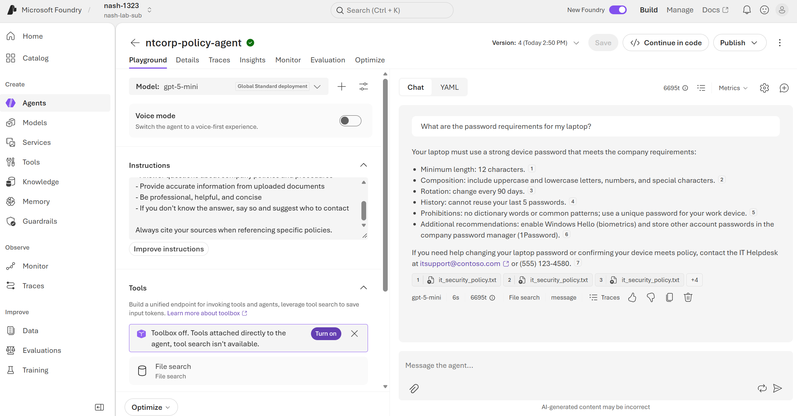
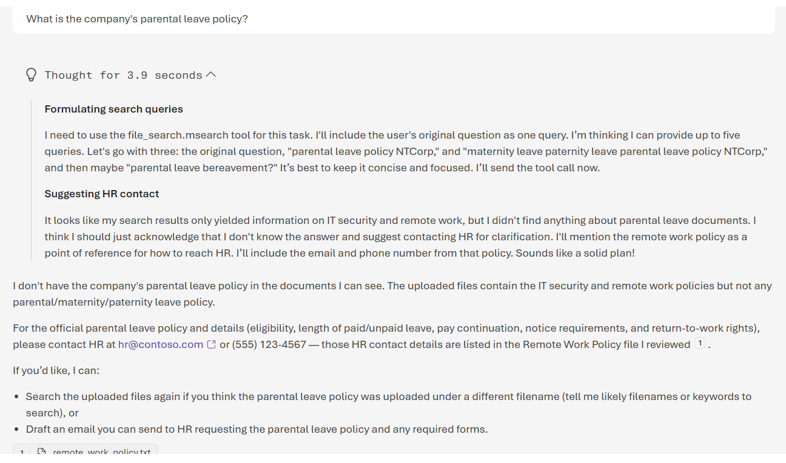
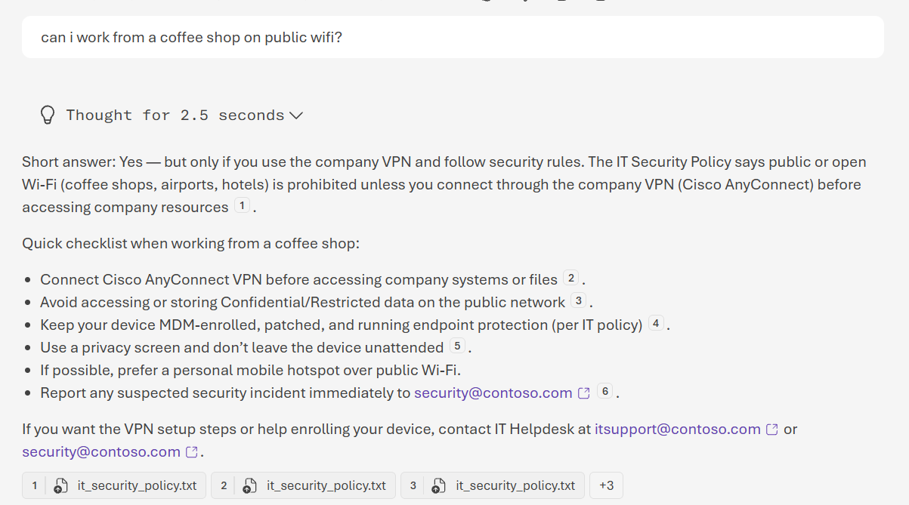
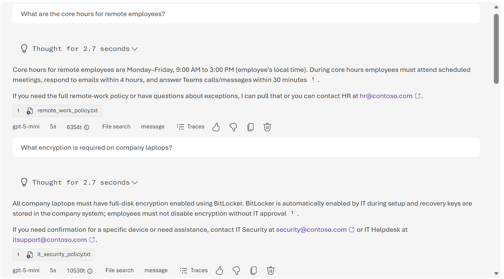
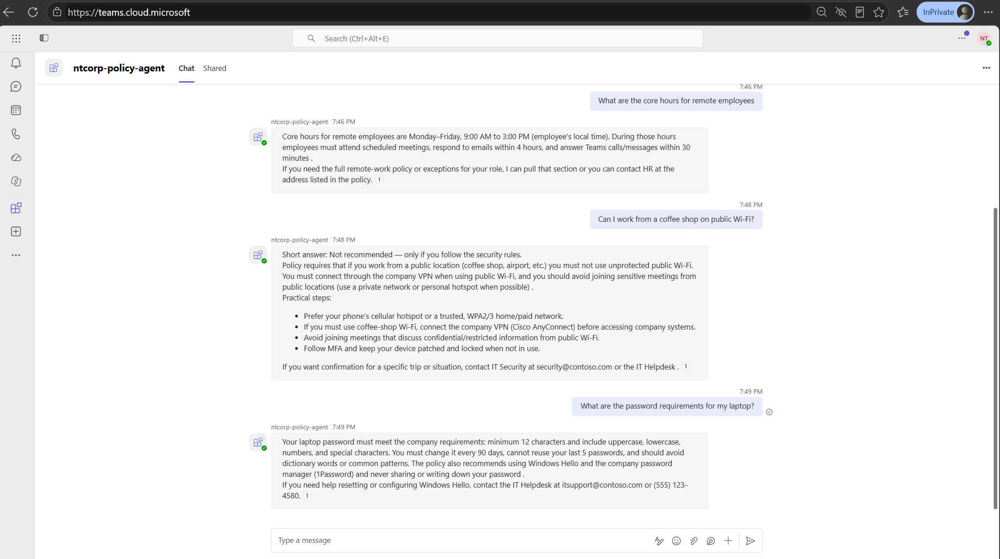

# NTCorp Policy Agent: an AI assistant for company policies in Microsoft Teams

An AI agent built in **Microsoft Foundry** that answers employee questions about **IT security** and **remote work** policies, using only the company's own documents, with citations. It is published to **Microsoft Teams**, so employees ask it questions where they already work.

**Low-code project:** everything was built in the Foundry portal, the Azure portal and Teams. No code to deploy.

| | |
|---|---|
| **Agent** | `ntcorp-policy-agent` (Microsoft Foundry, model **gpt-5-mini**) |
| **Knowledge** | 2 policy documents, searched with **File search** (RAG) |
| **Delivered in** | Microsoft Teams |
| **Built** | November 2026 (20–25 Nov) |
| **Cost** | A few cents of model usage, with a $5 budget alert. Everything deleted afterwards |
| **Status** | ✅ Completed, tested in Teams, resources cleaned up |

---

## 1. The problem and why it matters

Employees lose time hunting through long policy documents for simple answers: *How long must my password be? What are my core hours? Can I work from a coffee shop?* They either guess, or they email IT and HR, who answer the same questions again and again.

**The solution:** an AI assistant that has *read the company's policy documents* and answers in plain language, **inside Microsoft Teams**, **with a citation** to the policy it used. When the documents don't cover a question, it says so and points to the right contact instead of making something up.

**Why it matters:** faster answers for employees, fewer repetitive tickets for IT and HR, and answers people can trust because they can see the source. This is the same pattern many companies are adopting right now: an AI assistant *grounded* in their own knowledge, delivered inside the tools staff already use.

> **Everyday analogy:** a general chatbot is like asking a friend who has read the whole internet. This agent is like asking a colleague who has read *your company's handbook*, keeps it open in front of them, and shows you the page.

**Fictional company:** NTCorp is my lab company. The sample policy documents still say *Contoso Corporation* (Microsoft's standard fictional company name) inside the text; I kept them unchanged so the test answers match.

---

## 2. Architecture

```
  Employee in Microsoft Teams
            │  "What are the core hours?"
            ▼
  Azure Bot Service  (created automatically when I published)
            │
            ▼
  Microsoft Foundry project  nash-1323   (resource group rg-nash-4219, West US 3)
  ┌───────────────────────────────────────────────────────────┐
  │ Agent: ntcorp-policy-agent   (Version 4)                  │
  │  ├─ Instructions: "NTCorp Policy Assistant"  (role, tone, │
  │  │                 cite sources, say "I don't know")      │
  │  ├─ Model: gpt-5-mini                                     │
  │  └─ Tool: File search ──► vector store                    │
  │                            ├─ it_security_policy.txt      │
  │                            └─ remote_work_policy.txt      │
  │  (Web search tool removed on purpose)                     │
  └───────────────────────────────────────────────────────────┘
            │
            ▼
  Answer + citation back in Teams
```

**How an answer is made (RAG, Retrieval-Augmented Generation):**
1. **Retrieve:** File search looks up the parts of the policy documents that match the question.
2. **Augment:** those passages are handed to the model together with the question and my instructions.
3. **Generate:** the model writes a short answer from those passages and cites the file.

The model is **not trained** on my documents. It reads the relevant pages at question time, like an open-book exam.

---

## 3. Tools and services: what I chose, why, and the alternatives

| Need | What I used | Why | Alternatives |
|---|---|---|---|
| Work account (Teams agents don't accept personal Outlook accounts) | **Microsoft 365 Business trial**: lab org *Nash Lab*, account `nash@ntailab.onmicrosoft.com` | Free for 1 month and I'm the admin, so no approvals needed | A real company/school account; the M365 Developer Program sandbox (now mostly limited to Visual Studio subscribers) |
| Azure subscription in the **same** organization | **`nash-lab-sub`** on the *Microsoft Azure Plan* (pay-as-you-go) + **$5 budget alert** | My personal Azure free credit had expired, and the subscription must live in the same org as Teams | Azure free account (one per person); moving an existing subscription to the new org (advanced) |
| Build the agent | **Microsoft Foundry** (ai.azure.com, *New Foundry* experience) | Agent, model, document search and publishing to Teams in one portal, no code | Copilot Studio (more business-user oriented); writing an agent with code (Foundry SDK, LangChain); Amazon Bedrock Agents on AWS |
| Language model | **gpt-5-mini** (auto-deployed with the project) | Small, fast and cheap, more than enough to answer from two documents | gpt-4.1-mini, gpt-4o, or larger models (more cost, no benefit here) |
| Company knowledge | **File search** tool with 2 uploaded `.txt` files | Built-in RAG: upload, it indexes automatically | Azure AI Search index (for large document sets), SharePoint as a knowledge source |
| Stop off-topic / internet answers | **Removed the default Web search tool** | Answers must come only from company documents (see [step 3](docs/03-create-and-ground-the-agent.md)) | Keep Web search (only makes sense for a general assistant) |
| Where employees use it | **Microsoft Teams** via *Publish to Teams and Microsoft 365* | Employees already live in Teams; one publish creates the bot and the app | Microsoft 365 Copilot (needs a Copilot licence, see [known limitation](docs/07-m365-copilot-known-limitation.md)), a web chat page |
| Tracking the work | GitHub (this repo), Jira | Documentation and progress visible to my trainer and employers | — |

---

## 4. Step-by-step guide (what I actually did)

| # | Step | What happens |
|---|---|---|
| 0 | [Plan the project](docs/00-plan-the-project.md) | Problem, design decisions, names I chose |
| 1 | [Accounts, subscription and budget](docs/01-accounts-subscription-and-budget.md) | Lab organization, Azure subscription `nash-lab-sub`, $5 budget alert |
| 2 | [Create the Foundry project](docs/02-create-the-foundry-project.md) | Foundry creates project `nash-1323` with gpt-5-mini |
| 3 | [Create and ground the agent](docs/03-create-and-ground-the-agent.md) | `ntcorp-policy-agent`, instructions, 2 documents, Web search removed |
| 4 | [Test in the playground](docs/04-test-in-the-playground.md) | 6 test questions, including 2 of my own and a hallucination test |
| 5 | [Publish to Teams](docs/05-publish-to-teams.md) | Register Microsoft.BotService, fill in the app details, Direct publish |
| 6 | [Test in Teams](docs/06-test-in-teams.md) | Find the app, chat with it, get a cited answer |
| 7 | [Microsoft 365 Copilot: known limitation](docs/07-m365-copilot-known-limitation.md) | Skipped: the trial has no Copilot licence |
| 8 | [Clean up (and troubleshooting)](docs/08-cleanup-and-troubleshooting.md) | Delete everything from the outside in |
| 9 | [Problems log / lessons learned](docs/09-problems-log.md) | Every issue I hit, its cause, the fix and why it matters |
| 10 | [Portfolio card and LinkedIn post](docs/10-portfolio-and-linkedin.md) | How I share the result |

**Test results:** see [agent/test-questions.md](agent/test-questions.md). All 6 passed.

---

## 5. Screenshots

Screenshots are stored in [`docs/images/`](docs/images/). See [docs/images/README.md](docs/images/README.md) for the list of file names.

| Step | Screenshot |
|---|---|
| Playground: password question with citation |  |
| Playground: parental leave (says it doesn't know) |  |
| Playground: coffee shop public Wi-Fi → VPN |  |
| Playground: core hours and encryption |  |
| Teams: 3 questions answered with citations |  |

---

## 6. Cost

| Item | Cost |
|---|---|
| Microsoft 365 Business trial | $0 (recurring billing turned off; it would otherwise renew at $89.55/year) |
| Model usage (gpt-5-mini) for all test questions | A few cents |
| File search storage for 2 small documents | Fractions of a cent for a few days |
| Azure Bot Service (Teams channel) | $0 at this usage |
| **Total** | **A few cents.** Guarded by a $5 budget alert, and all resources deleted on 25 Nov 2026 |

> A budget in Azure is a **smoke alarm, not a sprinkler**: it emails you when spending passes the amount, it does not stop the spending. Deleting the resources is what stops costs.

---

## 7. Repository layout

```
nt_policy_agent/
├── README.md                     <- this page
├── agent/
│   ├── instructions.txt          <- the exact instructions I gave the agent
│   └── test-questions.md         <- my 6 test questions and results
├── data/sample_documents/
│   ├── it_security_policy.txt    <- grounding document 1 (text says Contoso)
│   └── remote_work_policy.txt    <- grounding document 2 (text says Contoso)
└── docs/
    ├── 00 … 10 step pages        <- the step-by-step guide
    └── images/                   <- screenshots
```

---

## 8. What I learned

- **Grounding beats a clever prompt.** The agent is only trustworthy because it answers from the documents and cites them. Removing Web search was as important as adding File search.
- **Test what the agent should *not* answer.** The parental leave question proves it says "I don't know" instead of inventing a policy.
- **Identity comes first in Microsoft cloud work.** Most of the setup time was accounts and organizations (personal vs work account, same tenant for Azure and Teams), not the AI itself.
- **Clean up from the outside in**, the same way you'd dismantle a deployment: users' entry point first, the cloud resources last, billing at the very end.

## 9. Future improvements

- Add more policy documents (HR, expenses) and rename the sample text from Contoso to NTCorp.
- Publish to the whole organization (needs admin approval) and to Microsoft 365 Copilot (needs a Copilot licence).
- Automate creating and testing the agent with the Foundry SDK and a CI pipeline, so the test questions run on every change (the DevOps version of this project).
- Use Azure AI Search or SharePoint as the knowledge source for a larger document set.

## 10. Useful links

- What is Microsoft Foundry? https://learn.microsoft.com/en-us/azure/ai-foundry/what-is-azure-ai-foundry
- Foundry Agent Service pricing: https://azure.microsoft.com/en-us/pricing/details/foundry-agent-service/
- Microsoft 365 Copilot documentation: https://learn.microsoft.com/en-us/microsoft-365/copilot/

---

*Built by Nadege Tenku. NTCorp and Contoso are fictional companies.*
